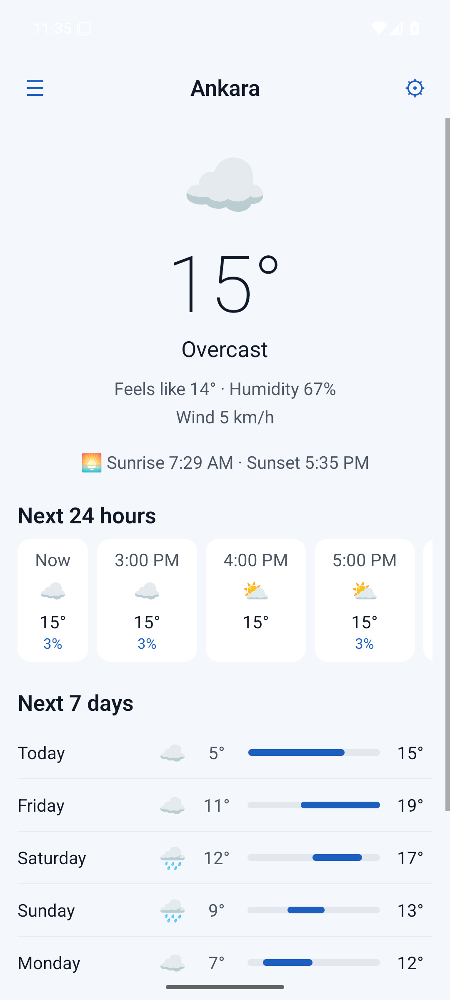
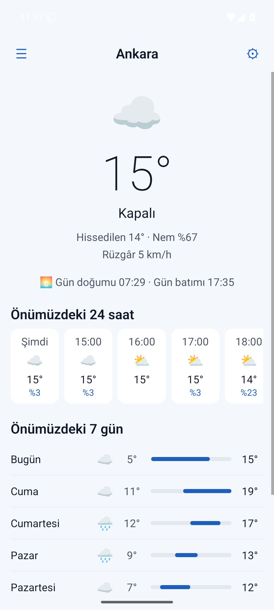
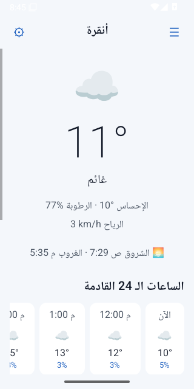
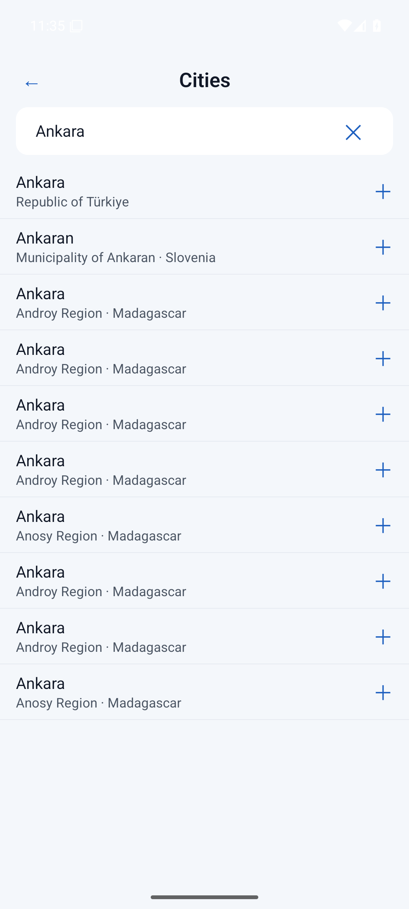
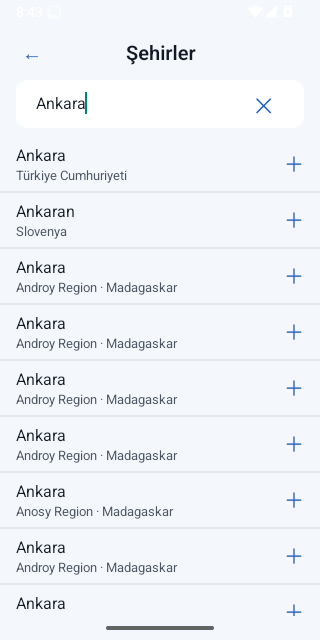
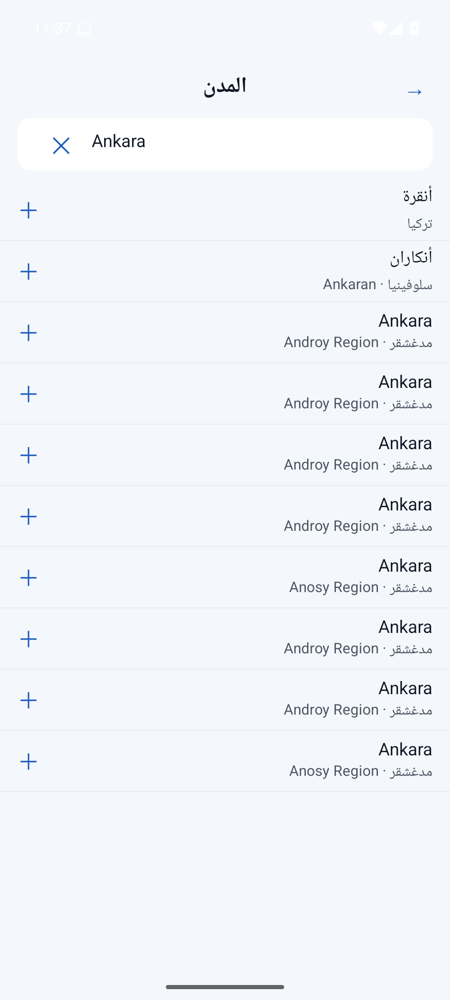
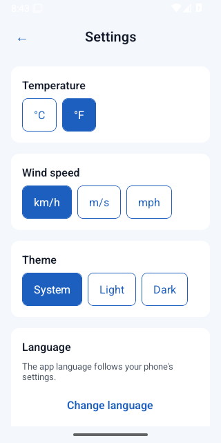
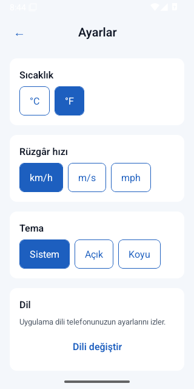
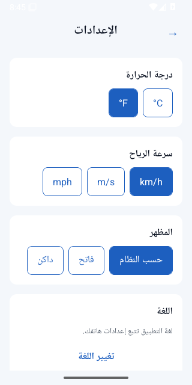

# Atmos — React Native

**A weather app for Android and iOS from one TypeScript codebase, built step by step as a
public tutorial on professional React Native development with Clean Architecture and an AI
coding agent.**

<!-- step-banner:start -->
> ### 📍 You are on `main`: the finished app
> This branch is the complete app. To **learn how it was built**, start at
> [**Step 01 — Planning: documents before code**](https://github.com/AhmedJAbuSada/atmos-react-native/tree/step-01-planning) and follow the steps in order:
> each step branch has its own README that explains what that step is, why it exists,
> and what changed. All steps: [ROADMAP.md](docs/ROADMAP.md).
<!-- step-banner:end -->


-blue)


> ✅ **v1.0.0:** all seven steps are done. 226 tests in Node, plus the main journey on an
> Android emulator in English, Turkish and Arabic on every push.

## Screenshots
The release build on an Android emulator, recorded by CI ([step 07](docs/steps/07-quality-release.md)).

| English | Türkçe | العربية (right to left) |
|---|---|---|
|  |  |  |
|  |  |  |
|  |  |  |

## Run it
Node 22, and the Android SDK and/or Xcode with CocoaPods, as in the
[React Native environment setup](https://reactnative.dev/docs/set-up-your-environment).
```bash
npm install
npm test                         # typecheck: npm run typecheck · lint: npm run lint
npm run android                  # or: cd ios && pod install && cd .. && npm run ios
```
No API key is needed. To see Arabic or Turkish, change the app's language in the phone's
settings.

## How it is built
```
src/domain        pure TypeScript: entities, use cases, Result errors (no React)
src/data          fetch + DTOs, mappers, AsyncStorage, location → domain interfaces
src/presentation  props-only views, Zustand view models, i18next, theme
src/app           composition root, navigation, the real entry point (main.tsx)
```
ESLint enforces the arrows ([ADR-0001](docs/architecture/adr/0001-clean-architecture-with-eslint-boundaries.md)).
Full picture: [ARCHITECTURE.md](docs/architecture/ARCHITECTURE.md).

## The same app on four platforms

| Platform | Repository | Status |
|---|---|---|
| Android (Kotlin, Compose) | [atmos-android](https://github.com/AhmedJAbuSada/atmos-android) | ✅ v1.0.0 |
| iOS (Swift, SwiftUI) | [atmos-ios](https://github.com/AhmedJAbuSada/atmos-ios) | ✅ v1.0.0 |
| **React Native** (TypeScript) | you are here | ✅ v1.0.0 |
| Flutter (Dart) | [atmos-flutter](https://github.com/AhmedJAbuSada/atmos-flutter) | 🚧 |

## The seven steps

| Step | Branch | What you learn |
|---|---|---|
| 01 | [`step-01-planning`](../../tree/step-01-planning) | Shared product docs, React Native architecture, ADRs, AI agent rules |
| 02 | [`step-02-project-structure`](../../tree/step-02-project-structure) | Bare React Native, TypeScript strict, ESLint boundaries, Jest, CI |
| 03 | [`step-03-domain-layer`](../../tree/step-03-domain-layer) | Entities, use cases, `Result` errors |
| 04 | [`step-04-data-layer`](../../tree/step-04-data-layer) | fetch + DTOs, mappers, AsyncStorage, location |
| 05 | [`step-05-presentation-ui`](../../tree/step-05-presentation-ui) | Screens as props-only views, theme, i18next, RTL |
| 06 | [`step-06-integration`](../../tree/step-06-integration) | Zustand view models, navigation, permissions |
| 07 | [`step-07-quality-release`](../../tree/step-07-quality-release) | Maestro end-to-end, screenshots, release |

Full details: [ROADMAP.md](docs/ROADMAP.md).

## Features (v1.0)
Current weather at your location · 24 hours and 7 days · city search with names in your
language · saved cities · offline with the last data · °C/°F and wind units · dark mode ·
**English, Türkçe, العربية** (right to left). Weather data by
[Open-Meteo.com](https://open-meteo.com/); no API key needed.

> **Note on translations:** the Turkish and Arabic texts are written with an AI agent and have
> not yet been reviewed by a native speaker.

## 🤖 Built with an AI agent
[AI_WORKFLOW.md](docs/AI_WORKFLOW.md) · [AGENTS.md](AGENTS.md) ·
[docs/ai/prompts/](docs/ai/prompts/) · every step guide ends with *how the AI agent helped*.

## Author
**Ahmed J. AbuSada**, senior mobile and front-end developer ·
[@AhmedJAbuSada](https://github.com/AhmedJAbuSada)

## License
[MIT](LICENSE). Weather data © Open-Meteo.com, [CC BY 4.0](https://creativecommons.org/licenses/by/4.0/).
