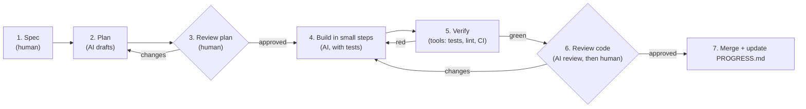

# Working with an AI coding agent — the professional way

Atmos is built by a human developer working with **Claude Code**, an AI coding agent.
This document shows *how*, so you can copy the method into your own projects.

> **The short version:** the AI is a very fast, very well-read pair programmer. It is not
> the tech lead. The human owns the **what**, the **why**, and the final **yes**. The AI
> speeds up the **how**, and the process below catches its mistakes before they reach
> `main`.

---

## 1. The loop

| Step | Who | Output |
|---|---|---|
| 1. Spec | Human | A user story with acceptance criteria ([USER_STORIES.md](product/USER_STORIES.md)) |
| 2. Plan | AI drafts, human edits | A list of files to change, tests to write, risks |
| 3. Review the plan | Human | Approval *before* any code. Fixing a plan is cheap; fixing code is not. |
| 4. Build | AI | Small commits, tests written together with the code |
| 5. Verify | Tools | `npm run typecheck && npm run lint && npm test` + CI. Machines check what machines can. |
| 6. Review | AI first, then a human | The AI catches the obvious; the human checks intent, design and edge cases. |
| 7. Merge | Human | Green CI, an approval, an updated `PROGRESS.md` |

## 2. Give the agent memory: rules files

An agent starts every session with no memory. Three files give it the context a new team
member would get in their first week:

| File | Purpose |
|---|---|
| [`AGENTS.md`](../AGENTS.md) | The rules: architecture, code style, tests, what never to do. Read by most AI tools. |
| [`CLAUDE.md`](../CLAUDE.md) | Claude Code's entry point; imports `AGENTS.md`. |
| [`docs/PROGRESS.md`](PROGRESS.md) | Where we are, what is done, what is next. The **hand-over note** between sessions. |

**Why it works:** without these files, you repeat the same instructions in every prompt,
and the agent drifts (it imports `react-native` into the domain "because it was easier"). With
them, the rules are loaded every time, and a reviewer can point to a line.

**Session hand-over:** this project was built across several AI sessions (sessions have
usage limits). Each session ended by updating `PROGRESS.md`, committing and pushing. The
next session started with "read `PROGRESS.md` and continue". Human teams use the same
trick for hand-overs and holidays.

## 3. Writing prompts that work

### ❌ Vague
> Make a weather app screen.

The agent has to guess the architecture, the states, the libraries and the design. It
will guess differently from you.

### ✅ Specific
> Implement **US-04 (city search)** from `docs/product/USER_STORIES.md`.
> Scope: `SearchCitiesUseCase` in `src/domain` and its tests only. No UI yet.
> Follow `AGENTS.md`. The repository protocol already exists in
> `src/domain/location/repositories.ts`.
> Write the tests first, one per acceptance criterion, using the criterion as the test
> name. Then implement. Then run `npm test -- src/domain` and show me the output.

What makes it work:
1. **Points to the spec** instead of re-describing it.
2. **Limits the scope** ("domain only, no UI"), so the diff stays reviewable.
3. **Names the files** and existing code to build on.
4. **Asks for tests first** and for **proof** (the test output).

The real prompts used for every step are in [`docs/ai/prompts/`](ai/prompts/).

## 4. What to delegate, and what not to

| ✅ Great for the agent | ⚠️ Agent drafts, human decides | ❌ Never delegate |
|---|---|---|
| Boilerplate (DTOs, mappers, package setup) | Architecture and library choices (ADRs) | Merging to `main` without review |
| Tests from acceptance criteria | Public API and naming | Secrets, keystores, credentials |
| Translations (first draft) | UX copy and translations (native speaker reviews) | Accepting licences or terms |
| Refactors with tests as a safety net | Performance trade-offs | Decisions you cannot explain yourself |
| Explaining unfamiliar code or errors | Security-sensitive code | |
| First-pass code review | | |

**Rule of thumb:** if you could not explain the code in a review, you are not ready to
merge it, whoever wrote it.

## 5. Verify, don't trust

AI agents can be confidently wrong. The defences are the same ones good teams use with
human code, applied every time:

1. **Real data, not imagined data.** Before writing the API contract, we called the real
   Open-Meteo API and saved the responses in [`docs/api/samples/`](api/samples/). This
   showed things that do not appear in a "typical" example:
   - when no city matches, the geocoding API **omits the `results` key entirely** rather
     than returning `[]`;
   - the returned coordinates are **snapped to a grid**, so they must not be used as a
     cache key.

   An agent writing from memory would probably have missed both. The tests in step 04
   use these exact files.
2. **Tests prove behaviour.** The agent must show test output, not say "tests pass".
3. **Tools enforce rules.** ESLint boundaries make an architecture violation a *lint
   error* in CI. A lint rule makes `toUpperCase()` without a locale an *error*. Then nobody has
   to remember.
4. **Small diffs.** A 2,000-line AI-generated PR cannot be reviewed properly. Keep each
   prompt to a scope that produces a diff you can read in 10 minutes.
5. **Honest attribution.** Commits written with the agent carry a
   `Co-Authored-By: Claude` line. Being transparent about AI use is part of being a
   professional.

## 6. How the agent helped in each step

Each step guide in [`docs/steps/`](steps/) ends with a section **"How the AI agent helped
in this step"**: what it did, what the human reviewed, and what went wrong. Read them in
order to see the workflow evolve from documents to a finished app.
