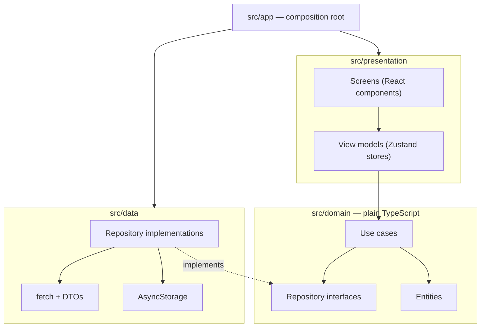
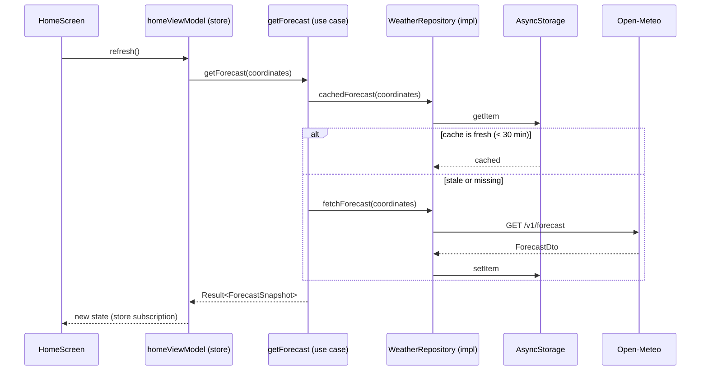

# Architecture

Atmos for React Native follows **Clean Architecture** with three layers, the same as the
[Android](https://github.com/AhmedJAbuSada/atmos-android/blob/main/docs/architecture/ARCHITECTURE.md)
and [iOS](https://github.com/AhmedJAbuSada/atmos-ios/blob/main/docs/architecture/ARCHITECTURE.md)
versions. One TypeScript codebase serves Android and iOS. The *reasons* for each choice are
in the [ADRs](adr/).

## 1. The one rule: dependencies point inwards



- `src/presentation` imports `src/domain`.
- `src/data` imports `src/domain`.
- `src/domain` imports **nothing**: no `react`, no `react-native`, no npm package with
  native code.
- Only `src/app` sees everything, to build the object graph (ADR-0004).

> **Why?** The business rules change least and matter most. With no framework imports
> they run in plain Node with Jest, in milliseconds. The network, the storage, or even the UI
> framework can change without touching a single rule.

## 2. How the rule is enforced

TypeScript has no modules with private boundaries like Gradle or Swift packages. The rule is
enforced by **ESLint** with
[`eslint-plugin-boundaries`](https://github.com/javierbrea/eslint-plugin-boundaries) (ADR-0001),
which knows the layers by folder:

| Layer (folder) | May import | Must not import |
|---|---|---|
| `src/domain` | only `src/domain` | `react`, `react-native`, `src/data`, `src/presentation` |
| `src/data` | `src/domain`, network and storage libraries | `src/presentation`, `react` |
| `src/presentation` | `src/domain`, React, React Native, UI libraries | `src/data` |
| `src/app` | everything | — |

ESLint runs in CI with `--max-warnings 0`, so a violation fails the build like a compile
error would.

```
atmos-react-native/
├── android/, ios/        → native projects (bare React Native CLI, ADR-0003)
└── src/
    ├── domain/           → entities, repository interfaces, use cases, Result
    ├── data/             → DTOs, API client, mappers, AsyncStorage, location
    ├── presentation/     → screens, view models, theme, formatting, i18n
    └── app/              → composition root, navigation container, App.tsx
```

## 3. Folders by feature inside each layer

```
src/domain/
├── weather/    forecast.ts, weatherCondition.ts, getForecastUseCase.ts …
├── location/   coordinates.ts, city.ts, cityUseCases.ts …
├── settings/   units.ts, userSettings.ts …
└── common/     result.ts, domainError.ts, dateProvider.ts
```

## 4. Data flow (one request)



## 5. Rules per layer

### Domain
- Plain TypeScript; `strict` compiler options.
- **Entities** are `readonly` types with domain names (`temperature`, not `temperature_2m`).
- **Use cases** are factory functions returning a function, for example
  `makeGetForecast({ repository, freshness })`, named after what they do.
- **Repository interfaces** speak in entities, never DTOs.
- Errors are values: fallible functions return `Promise<Result<T>>`, a discriminated union
  with a `DomainError` (ADR-0006). No exception crosses a layer boundary.
- Time comes from an injected `DateProvider`, never `Date.now()` in logic.

### Data
- **DTOs** mirror the JSON; every field is optional.
- **Mappers** are pure functions, tested against [`docs/api/samples`](../api/samples/).
- Repositories turn every network, HTTP and parsing failure into a `DomainError`.

### Presentation
- **Unidirectional data flow:** a screen reads one state object from its view model and calls
  its methods. Screens hold no business logic.
- **View models are Zustand stores** created by a factory with their use cases. They work
  without React, so they are tested like plain objects (ADR-0003).
- Each screen is split into a **container** (connects the store) and a **view** (props only),
  so every state can be rendered in tests without a store.
- All user-facing text comes from i18next resources in en, tr and ar (ADR-0005).

## 6. Cross-cutting concerns

| Concern | Where | How |
|---|---|---|
| Dependency injection | `src/app` | A composition root object, provided with React Context (ADR-0004) |
| Navigation | `src/app` + screens | React Navigation native stack, typed routes (ADR-0008) |
| Localization | `src/presentation/i18n` | i18next; `Intl` for numbers and dates; `I18nManager` for RTL |
| Settings | `src/data` (AsyncStorage) → domain | Observed through a small subscribe/notify store |

## 7. Testing strategy

| Layer | Test type | Tools | Target |
|---|---|---|---|
| Domain | Unit | Jest, in-memory fakes | ≥ 90% |
| Data | Unit + integration | Jest, a fake `fetch` replaying the recorded samples, an in-memory AsyncStorage | ≥ 80% |
| Presentation | View models; components | Jest, React Native Testing Library | Every view model; every screen state |
| App | End to end | Maestro on an Android emulator, real API | The main journey |
