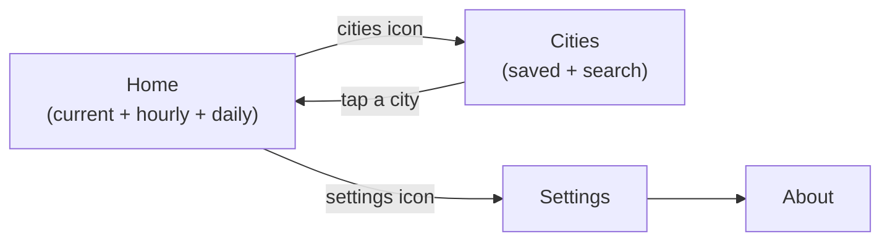

# Wireframes

Low-fidelity wireframes for the four screens. They are deliberately plain: at this stage
we agree on **content and flow**, not colours. The visual design system arrives in
`step-05-presentation-ui`.

> **Why ASCII?** It lives in Git, shows up in code review, and an AI agent can read it.
> Teams usually use Figma; the principle is the same: agree on the screen *before* coding
> it.

## Navigation



## 1. Home (US-01, US-02, US-03, US-07)

```
┌──────────────────────────────────┐
│ ☰ Cities      İstanbul       ⚙︎   │  ← top bar: city name in the app language
│ ⚠ Last updated 2 h ago (offline) │  ← only when data is stale (F-08)
│                                  │
│              ☁️                  │
│             15°                  │  ← temperature, large
│          Overcast                │
│      Feels like 11° · 💧 69%     │
│        💨 25 km/h                │
│                                  │
│ ── Next 24 hours ─────────────── │
│ ┌────┐┌────┐┌────┐┌────┐┌────┐   │  ← horizontal list; mirrors in RTL
│ │Now ││11  ││12  ││13  ││14  │ → │
│ │ ☁️ ││ ☁️ ││🌦 ││🌧 ││🌧 │   │
│ │15° ││15° ││16° ││14° ││13° │   │
│ │    ││    ││20% ││70% ││80% │   │  ← hidden when 0% (US-02)
│ └────┘└────┘└────┘└────┘└────┘   │
│                                  │
│ ── 7 days ────────────────────── │
│ Today      ☁️    11° ━━━━━ 17°   │
│ Thursday   ☁️    16° ━━━━━ 21°   │
│ Friday     🌧    13° ━━━   18°   │
│ ...                              │
│                                  │
│     Weather data by Open-Meteo   │
└──────────────────────────────────┘
          ↓ pull to refresh
```

**States:** loading → skeleton blocks in the same layout; error → message + "Try again";
no location and no saved city → "Search for a city" call to action.

## 2. Cities (US-04, US-05)

```
┌──────────────────────────────────┐
│ ←  Cities                        │
│ ┌──────────────────────────────┐ │
│ │ 🔍 Search city…              │ │  ← debounced 300 ms, min 2 chars
│ └──────────────────────────────┘ │
│                                  │
│ 📍 Current location       15° ☁️ │  ← always first, cannot be removed
│ ──────────────────────────────── │
│ Ankara                    12° 🌧 │  ← swipe to remove, with Undo
│ London                     9° 🌫 │
│                                  │
└──────────────────────────────────┘

While typing:
┌──────────────────────────────────┐
│ ←  ┌──────────────────────────┐  │
│    │ 🔍 ista              ✕   │  │
│    └──────────────────────────┘  │
│ İstanbul                     ＋  │
│ İstanbul · Türkiye               │
│ İstanbulboğazı               ＋  │
│ Ordu · Türkiye                   │
└──────────────────────────────────┘
```

## 3. Settings (US-08)

```
┌──────────────────────────────────┐
│ ←  Settings                      │
│ Temperature      ( °C ) (  °F )  │
│ Wind speed  (km/h) ( m/s ) (mph) │
│ Language                 System ›│  → System / English / Türkçe / العربية
│ Theme                    System ›│  → System / Light / Dark
│ ──────────────────────────────── │
│ About                           ›│
└──────────────────────────────────┘
```

## 4. About (US-10)

```
┌──────────────────────────────────┐
│ ←  About                         │
│            Atmos                 │
│         Version 1.0.0            │
│ Weather data by Open-Meteo.com ↗ │
│ Source code on GitHub ↗          │
│ License: MIT                     │
└──────────────────────────────────┘
```

## RTL (Arabic) rule of thumb

Everything that has a direction mirrors: the back arrow, the list direction, the
alignment of text, and the min→max bar. **Numbers, temperatures and icons do not mirror.**
A sun is still a sun.
